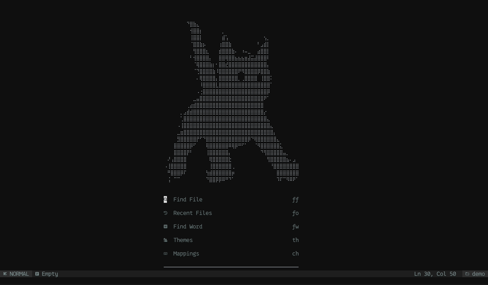
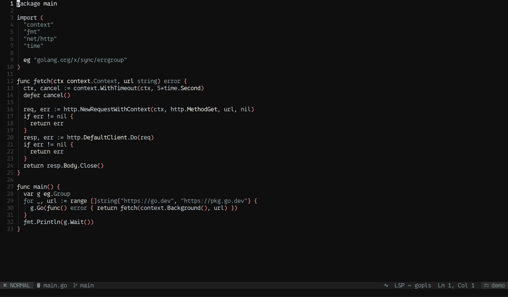
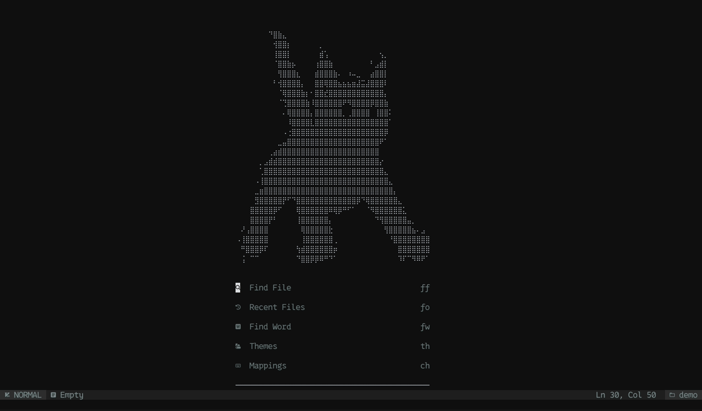
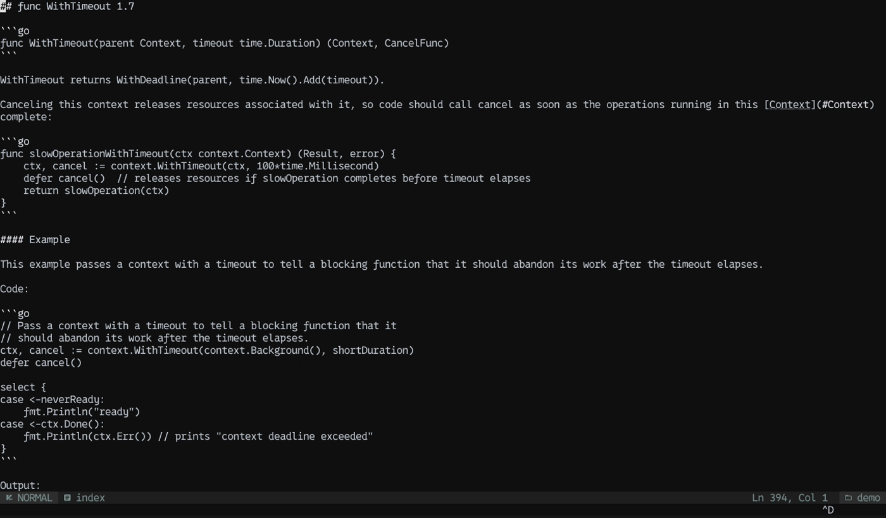

# rtfm.nvim

> Have you ever had to read docs while coding?
> Have you ever wanted to never, ever leave Neovim?
> **rtfm.nvim** — read the manual without leaving your editor.

rtfm searches documentation, renders pages as Markdown buffers, and knows *which* docs you
need: the exact versions your project depends on, the symbol under your cursor, and the
answer to a question even when you don't know the API name. All of it works offline.



## Why

I live in Neovim, and my fingers know its motions better than my own handwriting. Opening docs in
the browser was never a big problem, but it meant switching to a whole different way of moving
around: mouse, tabs, scroll, `Ctrl+F`. I tried Tridactyl to get Vim keys in Firefox, and it's
genuinely good, but I never fully got used to it. So I flipped the problem around: instead of making
the browser feel like Neovim, why not bring the docs into Neovim? (Also, leaving Neovim is
overrated.)

It grew a few opinions along the way. These days it's easy to skip the docs entirely and just ask a
model. That's handy, right up until the answer is for a different version than yours, or describes
a function that doesn't exist. rtfm treats the documentation itself as the source of truth, for
the exact version your project uses. There is a model in here, but it's a small one (about 45 MB)
running on your own machine, and its only job is to help you *find* the right section. It never
writes the answer for you. No API keys, nothing leaves your laptop, and it works on a plane.

It also turned out to be a better way to learn. When you're new to a language or library, the
hardest part is that you don't know what anything is called, so you can't search for it. You can
ask rtfm in plain English, "how do I wait for multiple goroutines to finish", and instead of a
ready-made answer you get the actual page for `sync.WaitGroup`: the explanation, the examples, the
caveats, and links to everything around it. You come away knowing the name of the thing and where
it lives, which is what makes the next question easier.

Sometimes the most useful tool is the one that just helps you read the manual.

## See it

**Docs for the symbol under your cursor, at the version you actually use.** `gK` on
`http.NewRequestWithContext` asks the LSP where it's defined, works out the package and version, and
opens that page in a split, scrolled to the symbol:



**Ask in plain English.** A local embedding model searches your installed docs, so "wait for
multiple goroutines to finish" finds `sync.WaitGroup` even if you've never heard of it:



**Offline.** With the network switched off, remote sources say so, and installed docs keep working:


## Features

- **Version-aware docs.** Reads `go.mod`, `Cargo.toml`/`Cargo.lock`, `package.json` (+ npm/pnpm/yarn
  lockfiles), `pyproject.toml`/`requirements.txt`/`uv.lock`/`.python-version`, and opens docs for the
  versions you actually use: `net/http@go1.22.5`, `serde 1.0.200`, `React 18`, `Python 3.12`.
- **Docs for the symbol under the cursor.** `:Rtfm symbol` (map it to `K`/`gK`) asks your LSP where
  the symbol is defined, works out the package and exact version from the path, and opens the right
  page in a split, scrolled to the symbol. Falls back to reading your imports, then to search.
- **Local semantic search.** Installed docs are chunked by section and indexed with BM25. With a
  local embedding model (Ollama or any OpenAI-compatible server) you get hybrid search, so
  *"how do I cancel a request after a timeout"* finds `context.WithTimeout`.
- **Fully offline.** `:Rtfm install <source>` or `:Rtfm install project` downloads docs (and indexes
  them). After that, search, reading, link following and semantic search all work on a plane.
- **Lots of sources.** ~800 docs from [DevDocs](https://devdocs.io), every Go module on pkg.go.dev,
  every crate on docs.rs, GitHub Docs, MDN, any site with a `sitemap.xml`, and Algolia DocSearch
  sites you configure.
- **A proper reader.** Pages are clean Markdown (works great with `render-markdown.nvim` or
  `markview.nvim`), links are followable, with back/forward history, a table of contents, bookmarks
  and history.

No build step and no binaries: pure Lua plus `curl`.

## Requirements

- Neovim **0.10+**
- `curl`
- Optional: [Ollama](https://ollama.com) (or llama.cpp / LM Studio) for semantic search,
  `pandoc` for alternative HTML conversion, a Markdown renderer plugin for prettier pages

## Installation

[lazy.nvim](https://github.com/folke/lazy.nvim):

```lua
{
  dir = "~/source/repos/rtfm.nvim", -- or "<github-user>/rtfm.nvim" once published
  cmd = "Rtfm",
  keys = {
    { "<leader>dd", "<cmd>Rtfm<cr>", desc = "Docs" },
    { "gK", "<Plug>(rtfm-symbol)", desc = "Docs for symbol" },
    { "<leader>da", "<cmd>Rtfm ask<cr>", desc = "Ask the docs" },
  },
  opts = {},
}
```

`setup()` is optional; defaults are applied on first use.

## Usage

### The picker

`:Rtfm` opens the picker. Your project's docs come first (⚑), then favorites (★), recently used and
installed (●) sources.

1. Type to filter sources; `<Tab>`/`<CR>` picks one (it becomes a chip in the prompt).
2. Type a query. Local sources filter as you type; remote ones search after a short pause.
3. `<CR>` opens the page, `<S-CR>`/`<C-s>` in a split, `<C-v>` vsplit, `<C-t>` tab, `<C-y>` float.
4. `<BS>` on an empty prompt goes back to the source list.

| Key | Action |
|---|---|
| `<C-n>`/`<C-p>`, `<Down>`/`<Up>` | move |
| `<C-d>`/`<C-u>` | scroll the preview |
| `<C-f>` | toggle favorite source |
| `<C-b>` | bookmark the selected page |
| `<C-e>` | toggle semantic/keyword search (indexed sources) |
| `<C-g>` | open in browser |
| `<C-x>` | delete entry (bookmarks/history) |
| `<Esc>`/`<C-c>` | close |

> `<S-CR>` needs a terminal that can tell it apart from `<CR>` (kitty, WezTerm, Ghostty, foot…).
> `<C-s>` always works.

### Commands

| Command | |
|---|---|
| `:Rtfm` | open the picker |
| `:Rtfm {source} [query]` | search a source, e.g. `:Rtfm go context`, `:Rtfm python~3.12 json` |
| `:Rtfm! {source} {query}` | open the best match directly |
| `:Rtfm symbol` | docs for the symbol under the cursor |
| `:Rtfm ask [question]` | semantic search across everything indexed |
| `:Rtfm project` | this project's docs, at its versions |
| `:Rtfm install {source\|project}` | download for offline use (`project` also indexes) |
| `:Rtfm index {source\|project}` | build the semantic index (installs first if needed) |
| `:Rtfm installed` / `:Rtfm uninstall {source}` | manage installed docs |
| `:Rtfm bookmarks` / `:Rtfm history` | saved and recent pages |
| `:Rtfm favorite [source]` | toggle a favorite |
| `:Rtfm add {url} [name]` / `:Rtfm remove {id}` | add any docs site (via its sitemap) |
| `:Rtfm url {url}` | read any web page |
| `:Rtfm offline [on\|off]` | toggle offline mode |
| `:Rtfm cache clear` | clear the HTTP cache |
| `:checkhealth rtfm` | check the setup, including the embedding model |

Source ids: DevDocs slugs (`go`, `python~3.12`, `react~18`, aliases like `py`), `github`, `mdn`,
`gopkg` (all of pkg.go.dev), `gopkg:<module>@<version>` (e.g. `gopkg:std@go1.22.0`,
`gopkg:golang.org/x/sync@v0.10.0`), `docsrs`, `docsrs:<crate>@<version>`, `web`, and your own.

### Reading pages

Doc buffers are `filetype=markdown`, named `rtfm://<source>/<page>`.



| Key | Action |
|---|---|
| `<CR>` / `gd` | follow the link under the cursor (same site → rtfm, other sites → browser) |
| `<C-o>` / `<C-i>` | back / forward |
| `gO` | table of contents |
| `gx` | open the page in the browser |
| `yu` | yank the page URL |
| `ma` | bookmark (with an optional note) |
| `gs` | search this source |
| `q` | close |

## Semantic search setup

```sh
ollama pull all-minilm        # small and fast (~45 MB); or nomic-embed-text for better quality
```

```lua
require("rtfm").setup({
  index = {
    embed = { provider = "ollama", model = "all-minilm" },
    -- or an OpenAI-compatible server such as llama.cpp's:
    -- embed = { provider = "openai", url = "http://localhost:8080/v1", model = "bge-small-en" },
    -- embed = { provider = false } -- keyword (BM25) only
  },
})
```

Then `:Rtfm index project` (or `:Rtfm index go`). Indexing renders every page, splits it into
heading-scoped chunks, builds a BM25 index, and embeds the chunks in batches. Vectors are stored as
float32 and searched with LuaJIT FFI. Queries fuse the BM25 and vector rankings with reciprocal
rank fusion. Questions with four or more words switch to hybrid mode automatically; `<C-e>`
toggles it.

Embedding servers are local, so they are used even in offline mode.

## Adding docs

```lua
require("rtfm").setup({
  sources = {
    vue = { name = "Vue", adapter = "sitemap", url = "https://vuejs.org/sitemap.xml" },
    k8s = {
      name = "Kubernetes", adapter = "sitemap",
      url = "https://kubernetes.io/en/sitemap.xml", include = "^/docs/",
    },
    -- Algolia DocSearch: use the public search-only credentials the site gives you
    mydocs = {
      name = "My Docs", adapter = "algolia",
      app_id = "…", api_key = "…", index = "…",
      params = { facetFilters = { "language:en" } },
    },
    mdn = false, -- hide a builtin
  },
})
```

Or at runtime: `:Rtfm add https://docs.example.com/guide/` finds the sitemap and limits it to that
path.

## Configuration

Defaults, abbreviated (see `:h rtfm-config` for everything):

```lua
require("rtfm").setup({
  open = "buffer",          -- "buffer" | "split" | "vsplit" | "tab" | "float"
  offline = false,          -- never touch the network
  ui = { width = 0.85, height = 0.8, border = "rounded", preview = true },
  keymaps = { picker = { ["<C-s>"] = "open_split" }, viewer = { q = "close" } }, -- false disables a key
  viewer = { wo = { wrap = true, linebreak = true, conceallevel = 2 } },
  links = { same_site = "rtfm", other_site = "browser" },
  html = { converter = "builtin" }, -- "pandoc" | "auto"
  devdocs = { enabled = true, latest_only = true, only = nil },
  project = { enabled = true },
  symbol = { open = "split", lsp = true, timeout = 1500, keymap = nil },
  index = { embed = { provider = "ollama", model = "all-minilm" }, chunk_tokens = 300 },
  filetypes = { go = "gopkg", python = "python", lua = "lua~5.1", --[[ … ]] },
})
```

Highlight groups: `RtfmChip`, `RtfmMatch`, `RtfmKind`, `RtfmFavorite`, `RtfmProject`,
`RtfmInstalled`, `RtfmSemantic`, `RtfmSelection`, `RtfmCaret`, `RtfmFlash`, `RtfmTitle`, `RtfmFooter`.

Event: `User RtfmPageOpen` (with `data = { buf, page }`) fires when a page finishes loading.

## How it works

```
lua/rtfm/
  adapters/   devdocs, gopkg, docsrs, github, mdn, sitemap, algolia, web
  html/       tolerant HTML parser → main-content extraction → Markdown
  project/    manifest + lockfile parsers, version → doc source mapping
  symbol/     LSP definition → path → package@version → page#anchor
  index/      chunker, BM25, float32 vector store, embedding providers
  ui/         picker and doc viewer
```

Data lives in `stdpath("data")/rtfm` (installed docs, indexes, bookmarks, history), and the HTTP
cache in `stdpath("cache")/rtfm`. When the network is down, a stale cached copy is used.

## Development

```sh
make test             # offline test suite (fixtures, headless nvim)
make live             # smoke test against the real endpoints
./assets/record.sh    # re-record the README GIFs with vhs (uses your nvim config)
```

## License

MIT
